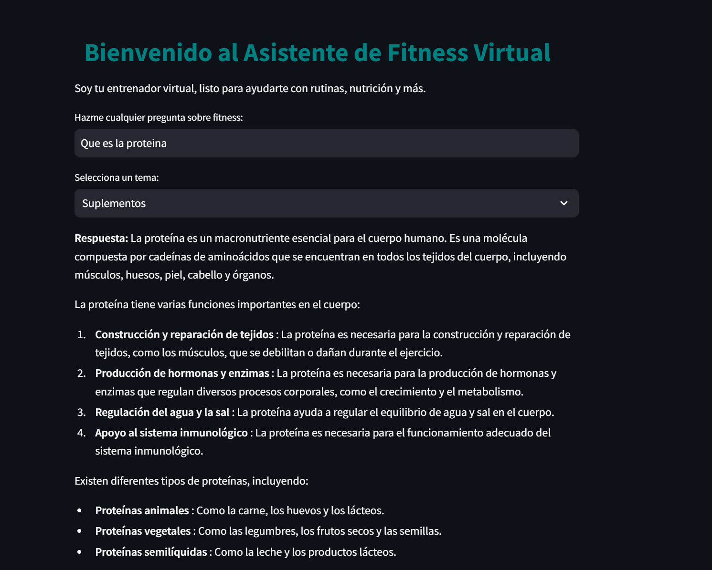

# 🤖 Fitness Assistant: Local LLM Chatbot with RAG

A conversational fitness assistant that runs **entirely on a local LLM** (Llama 3.2 via Ollama) and answers questions about exercise, nutrition and supplements using **Retrieval-Augmented Generation (RAG)** over PDF documents. Built with **LangChain** and a **Streamlit** chat interface.



## Why this project

General-purpose chatbots answer fitness questions from generic knowledge. This assistant grounds its answers in a curated set of documents (supplement data and strength-training movements). It runs locally, so no data leaves the machine and no paid API is needed.

## How it works

```
PDFs ──► PyPDFLoader ──► Ollama embeddings (llama3.2) ──► FAISS vector store
                                                              │
User question + chat history ──► ConversationalRetrievalChain ◄┘
                                          │
                                          ▼
                              Llama 3.2 (Ollama) ──► Streamlit chat UI
```

1. **Ingestion:** PDF documents are loaded with `PyPDFLoader`.
2. **Indexing:** Each document is embedded with Ollama embeddings and stored in a **FAISS** vector index.
3. **Retrieval and generation:** A LangChain `ConversationalRetrievalChain` retrieves the most relevant passages and passes them, together with the conversation history, to Llama 3.2.
4. **Interface:** Streamlit provides the chat UI, a topic selector (supplements, workout routines, nutrition) and a reset button.

## Tech stack

| Layer | Tools |
|---|---|
| LLM and embeddings | Ollama · Llama 3.2 |
| Orchestration | LangChain (`langchain-core`, `langchain-community`, `langchain-ollama`) |
| Vector store | FAISS |
| Document loading | PyPDF |
| Interface | Streamlit |

## Run it locally

**Prerequisites:** Python 3.10+ and [Ollama](https://ollama.com) installed.

```bash
# 1. Pull the model
ollama pull llama3.2

# 2. Install dependencies
pip install -r requirements.txt

# 3. Add your source documents to the project folder
#    (the app expects: Datos_suplementos.pdf, Movimiento_musculacion.pdf)

# 4. Launch the app
streamlit run ner.py
```

> The source PDFs are not included in this repository. Any fitness-related PDFs work; update `pdf_paths` in `ner.py` to point to your own files.

## Next improvements

- Wire the custom system prompt (fitness-coach persona) into the retrieval chain; it is defined but not yet passed to the chain.
- Use the topic selector to filter retrieval by document category.
- Persist the FAISS index to avoid re-embedding the PDFs on every run.
- Add entity extraction (NER) to personalize answers by user goals and constraints. The concept is outlined in [NER.md](NER.md).

## Author

**Manuel Montufar Galnares** · [LinkedIn](https://www.linkedin.com/in/manuel-montufar-galnares) · [GitHub](https://github.com/Manuel-Galnares)
